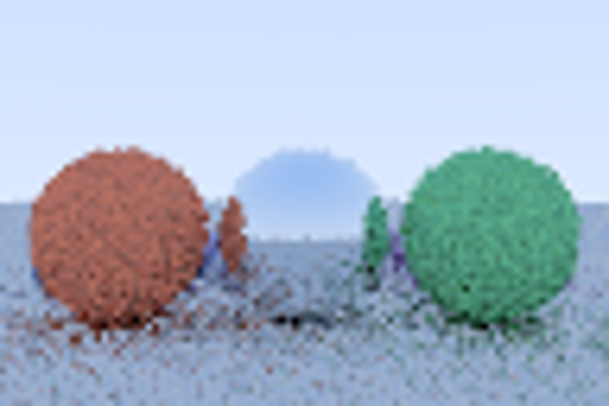

# CUDA path tracer

Bounded real-GPU path tracing with naive/BVH megakernels, stream-compacted wavefront
queues, and per-material GPU index queues feeding specialized diffuse/metal kernels.
The four modes run the same scene, integrator and counter-keyed samples.



## Run

Windows, VS 2022 C++ Build Tools, CUDA 13.0 and a Blackwell NVIDIA GPU are required;
the local build targets `sm_120`. From the repository root:

```powershell
cmd /c tools\build.cmd upstream
cmd /c tools\build.cmd
powershell -NoProfile -ExecutionPolicy Bypass -File tools/verify.ps1
python tools/check-evidence.py
```

`build/path-tracer.exe --doctor` reports the GPU. `build/path-tracer.exe evidence`
renders four 96x64 PPM files, four samples/pixel, eight bounces. Invalid arguments
return nonzero. The reusable lifecycle driver lives in
`.agents/skills/verify-cuda-path-tracer/SKILL.md`. There are no persistent processes;
cleanup preserves the evidence.

The isolated toolchain lives at `%USERPROFILE%/.codex/tools/coursework-cuda/toolkit`:
overlay `cuda_nvcc`, `cuda_cudart`, `cuda_crt`, `cuda_cccl`, `libnvvm` and `libcurand`
Windows x86-64 archives from NVIDIA's official
[13.0.2 manifest](https://developer.download.nvidia.com/compute/cuda/redist/redistrib_13.0.2.json).
Every archive was byte-count/SHA256 verified before extraction. Tools and NVIDIA
licenses stay outside Git. There is no global PATH mutation, driver installation,
unsupported-compiler bypass or watchdog change.

## Implementation and checks

`wavefront.cu` reuses upstream `vec3.h`. A host-built balanced median BVH is traversed
on the GPU with a checked fixed stack. Materials are cosine-weighted Lambertian and
perfect mirror. Camera jitter provides stochastic antialiasing. Stable path IDs and
keyed `(path,bounce,dimension)` sampling make queue reordering reproducible. Atomic
compaction reserves one full-capacity output slot per survivor. Grouping fills separate
diffuse and metal index queues before specialized shader launches. The owned procedural
scene contains 40 spheres; no external assets are required.

The first default-contraction experiment failed cross-kernel integrator parity;
`--fmad=false` gives the same explicit arithmetic policy across fused and split kernels.
The resulting maximum linear color difference is zero. This reproducibility choice
can affect performance.

[GPU evidence](evidence/verification.txt): RTX 5080 Laptop GPU, compute 12.0, driver
592.01, CUDA compiler 13.0.88, MSVC 14.44.35207. All 4,102 GPU BVH intersections agree
with naive traversal and an independent double-precision CPU oracle, including inside,
tangent, parallel and miss cases. All four renders have finite nonzero lighting,
identical linear colors and identical PPM pixels. Per-bounce counts are
`24576,14265,5718,2736,1634,1079,752,564`; kernels launched are 1/1/25/41 respectively.
Queue IDs are checked for range and duplicates at every bounce; counts match baseline.

One warmup precedes five runs per mode. CUDA event intervals surround the backend,
including synchronization, managed-memory transfers, host gaps and validation; these
are **not isolated kernel timings**. The tiny wavefront workload is slower, and no
speedup or production-scale conclusion is claimed. CI only checks retained historical
GPU artifacts and upstream integrity on CPU; it does not execute CUDA.
Three additional `raycast_kernel` timings bracket only the BVH raycast launch with
CUDA events recorded immediately around it; nonzero resulting hits prove the work.

The maintained [Google Benchmark fixture](tools/benchmark/README.md) ran seven frozen 360p/720p workloads on 22 October 2026, with four/sixteen samples per pixel, eight bounces and 40/404/1,604 spheres. It shares the actual renderer and checks every backend against independent ray and full-image oracles. Seven randomly interleaved framework repetitions per fixture passed. Wall milliseconds below are the framework median of repetition means, followed by their full range; these are not individual-frame percentiles.

| Workload | Naive mega | BVH mega | Compact wavefront | Grouped wavefront |
| --- | --- | --- | --- | --- |
| Room 360p, 4 spp | 0.457 [0.432,0.470] | 0.791 [0.741,0.827] | 9.607 [7.230,9.961] | 18.124 [12.419,18.561] |
| Room 360p, 16 spp | 1.775 [1.687,2.435] | 2.926 [2.809,3.126] | 24.032 [14.726,30.586] | 49.925 [40.598,100.140] |
| Lattice 360p, 4 spp | 3.164 [2.998,3.470] | 1.541 [1.499,1.593] | 7.926 [7.224,10.343] | 18.323 [16.710,19.091] |
| Lattice 360p, 16 spp | 11.904 [11.367,12.794] | 5.610 [5.463,5.827] | 32.141 [23.602,42.184] | 52.235 [42.745,131.828] |
| Dense 360p, 4 spp | 11.971 [11.187,13.056] | 2.274 [2.102,2.369] | 10.167 [9.550,10.726] | 19.054 [17.519,21.282] |
| Dense 360p, 16 spp | 46.520 [44.881,52.968] | 7.822 [7.447,9.064] | 47.909 [28.241,68.386] | 60.617 [54.015,88.379] |
| Room 720p, 4 spp | 1.798 [1.600,1.951] | 3.041 [2.918,3.264] | 27.444 [17.075,31.953] | 50.498 [26.869,91.723] |

BVH traversal helps the larger sphere sets and loses on the small room. Neither wavefront path beats the corresponding BVH megakernel here; grouped dispatch adds overhead. The room 360p/four-sample path launches 1/1/17/33 kernels with diagnostic validation disabled. Synchronous queue-count/material reads and unsupported Windows managed prefetch are observed implementation constraints, not a proven hardware-counter diagnosis. No source optimization or wavefront speedup is claimed from this campaign.

[Curated framework receipts](docs/evidence/metrics-summary.json) retain all 441 raw repetition rows, framework medians, nearest-rank p95/ranges, event spans, a separate single-kernel raycast fixture, source/adapter hashes and raw JSON hashes. The RTX 5080 Laptop GPU used driver 592.01 and CUDA 13.0.88 with Release host code and `--fmad=false`. Maximum managed payload is 457,280,428 bytes; this is logical allocation, not measured physical VRAM. Render CUDA event spans include host scheduling and managed-memory gaps. The frozen procedural scenes and diffuse/mirror integrator limit generalization. Profiling the actual limiter remains pending; installed Nsight command tools were unavailable. Reproduce with Build, Smoke and Measure in the linked fixture guide, then `python tools/summarize-benchmark.py`.

A separate same-binary A/B campaign removes only the host wait immediately after raycast in experimental compact/grouped fixtures. Same-stream consumers, launch-error checks, initialization wait and every synchronization before CPU managed-memory access remain. All seven Smoke and Measure cases passed: 637 measured oracle rows comprise 588 full final-image checks and 49 nonzero-hit raycast checks. Wall milliseconds are median [range] across seven interleaved repetition means:

| Workload | BVH control | Compact wait | Compact candidate | Grouped wait | Grouped candidate |
| --- | --- | --- | --- | --- | --- |
| Room 360p, 4 spp | 0.798 [0.765,0.859] | 9.523 [9.091,10.703] | 8.725 [8.341,13.358] | 18.071 [16.016,20.622] | 17.026 [16.190,18.031] |
| Room 360p, 16 spp | 3.151 [2.830,3.241] | 30.023 [28.053,35.684] | 23.950 [21.840,96.166] | 59.043 [49.134,100.474] | 51.215 [43.405,109.124] |
| Lattice 360p, 4 spp | 1.555 [1.529,1.695] | 10.228 [9.669,17.697] | 10.576 [9.051,23.170] | 19.010 [17.121,21.433] | 18.424 [16.667,36.730] |
| Lattice 360p, 16 spp | 5.563 [5.446,5.670] | 29.368 [24.254,46.239] | 24.589 [17.821,28.607] | 50.588 [36.897,98.974] | 49.676 [34.385,54.997] |
| Dense 360p, 4 spp | 2.198 [2.099,2.434] | 10.454 [8.307,14.618] | 9.594 [8.095,10.531] | 18.949 [17.201,19.515] | 18.343 [16.797,19.813] |
| Dense 360p, 16 spp | 7.446 [7.275,8.243] | 30.095 [24.624,62.514] | 25.205 [19.051,40.691] | 51.699 [27.189,91.103] | 45.255 [40.930,51.555] |
| Room 720p, 4 spp | 2.964 [2.909,3.065] | 28.629 [21.174,55.375] | 21.725 [19.216,72.844] | 49.429 [40.310,58.406] | 43.404 [28.113,45.786] |

Every one of the 28 compact/grouped wall and event A/B comparisons has overlapping ranges. Lower medians therefore do not establish a gain; the production default retains its wait. Both candidates remain slower than the same-run BVH control. [A/B receipts](docs/evidence/metrics-raycast-sync-summary.json) preserve all thirteen groups per workload, their raw repetitions, event medians/ranges, controls, source/adapter/binary identities and raw hashes; the [fixture guide](tools/benchmark/README.md) lists event intervals and exact commands. Managed payload is unchanged. Required host scheduling and Windows managed-memory migration remain within render event spans, so these cannot isolate kernel speed or identify migration as the dominant limiter. No extra profiling run or production behavior change is implied by this diagnostic.

## Sources and limits

Complete upstream history is retained from Roger Allen's
[Ray Tracing in One Weekend in CUDA](https://github.com/rogerallen/raytracinginoneweekendincuda),
branch `ch12_where_next_cuda`, SHA `ab140b12d4923b75270831baabab5e4d4209f305`.
Original source is unchanged; [original README](README.upstream.md) retains attribution.
The author explicitly dedicates the work to the public domain in the repository
description, captured in [metadata](evidence/upstream-repository.json). GitHub reports
no formal license file, so none is invented for upstream. The underlying Shirley book
code uses [CC0](https://github.com/RayTracing/raytracing.github.io/blob/release/COPYING.txt),
retained in [book-license.txt](evidence/book-license.txt). This is an educational 2018
base, not a maintained production renderer. Existing camera, dielectric, metal and
depth-of-field code is inherited; the new backend implements diffuse and mirror only.

The experiment is informed by the public
[UPenn instructions](https://github.com/CIS5650-Fall-2025/Project3-CUDA-Path-Tracer/blob/main/INSTRUCTION.md)
and [Laine/Karras/Aila 2013](https://research.nvidia.com/sites/default/files/pubs/2013-07_Megakernels-Considered-Harmful/laine2013hpg_paper.pdf).
No university/student skeleton is copied. This is not a submission, grader result or
claim of full assignment completion. No triangle/OBJ loader, emissive geometry, MIS,
captured-scene benchmark or production scheduler is included. Original `main.cu` builds
unmodified, but its large default render was not run.
