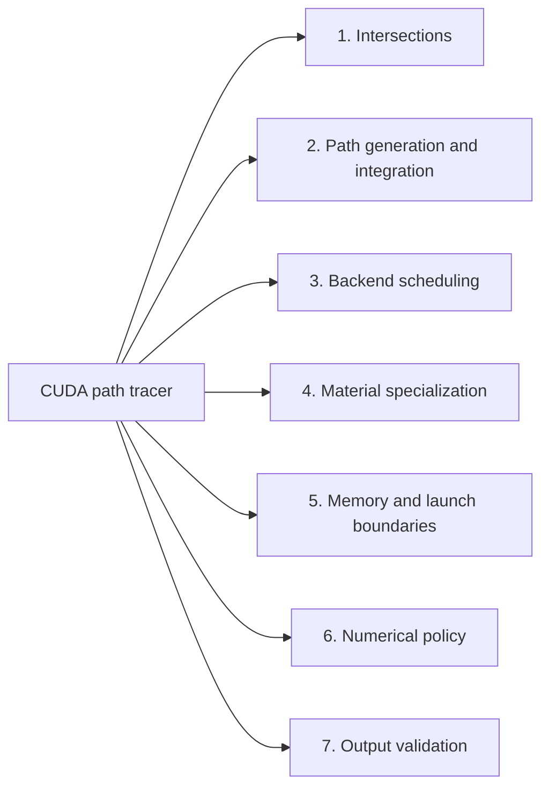
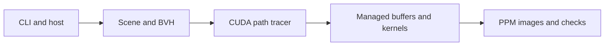
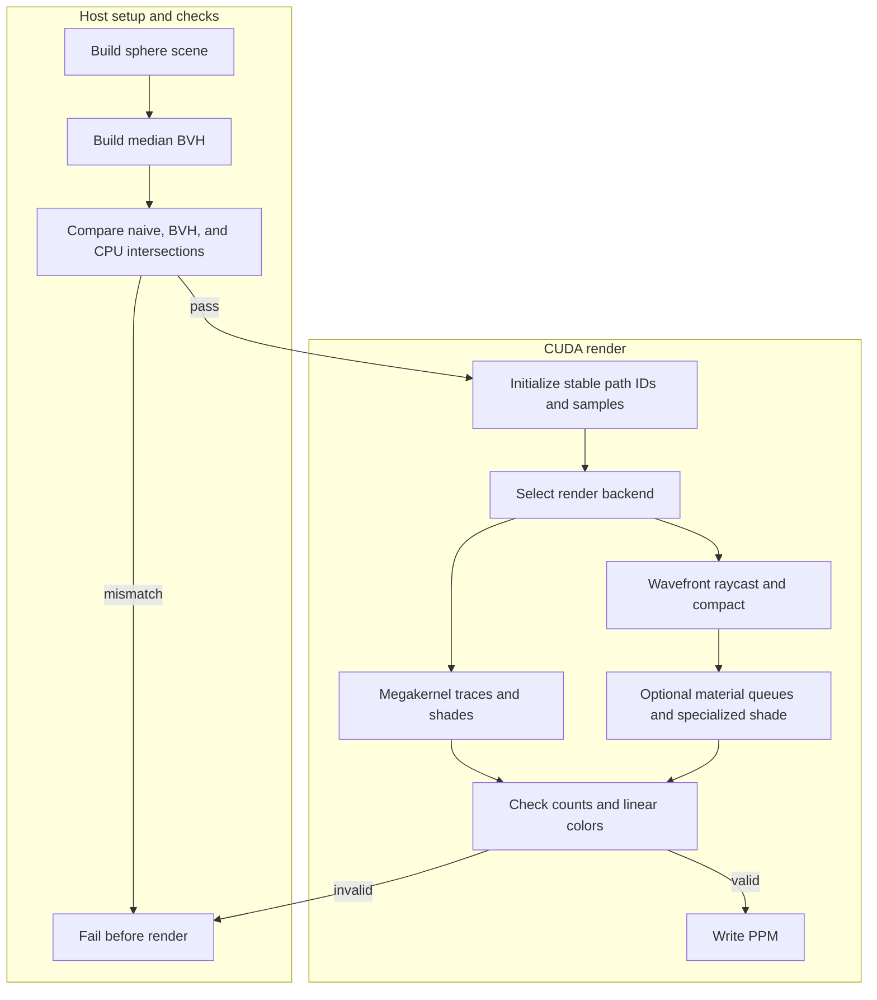

# CUDA path tracer

Bounded real-GPU path tracing with naive/BVH megakernels, stream-compacted wavefront
queues, and per-material GPU index queues feeding specialized diffuse/metal kernels.
The four modes run the same scene, integrator and counter-keyed samples.


## Contents
- [Implementation techniques](#implementation-techniques)

- [Architecture and execution guide](#architecture-and-execution-guide)
- [Run](#run)
- [Implementation and checks](#implementation-and-checks)
- [Sources and limits](#sources-and-limits)
- [Verification skill](.agents/skills/verify-cuda-path-tracer/SKILL.md)

## Architecture and execution guide

### Subsystem map

Select a subsystem in the diagram to open its techniques, tradeoffs, and code references. The numbered links provide the same navigation. This map groups components; the execution diagrams show their runtime flow.



1. [Intersections](#subsystem-intersections)
2. [Path generation and integration](#subsystem-path-generation-and-integration)
3. [Backend scheduling](#subsystem-backend-scheduling)
4. [Material specialization](#subsystem-material-specialization)
5. [Memory and launch boundaries](#subsystem-memory-and-launch-boundaries)
6. [Numerical policy](#subsystem-numerical-policy)
7. [Output validation](#subsystem-output-validation)

The project adds CUDA megakernel and wavefront render paths to an inherited educational path tracer. The active `wavefront.cu` path defines its own camera, ray, sphere, and scattering logic and reuses inherited vector math from `vec3.h`. The host builds a balanced [BVH](#bvh); CUDA kernels trace and shade paths using the same integrator and [counter-based samples](#counter-based-randomness). GPU profiling tools are unavailable, so launch timing does not identify the limiting hardware operation.

<details>
<summary>Expand flow diagram 1</summary>



</details>

The host creates the scene and owns dispatch and output files. Device kernels execute traversal and integration; the PPM writer and independent CPU checks run on the host.

<details>
<summary>Expand flow diagram 2</summary>



</details>

In wavefront mode each bounce traces current paths, compacts survivors, shades them, and checks queue capacity. The grouped mode adds [material queues](#material-queue) and incurs extra launches and synchronization. Render modes share keyed random samples, making pixel parity a meaningful check.

| Subsystem | Responsibility and invariant | Source |
| --- | --- | --- |
| Scene and host setup | Creates bounded sphere scenes, builds the median BVH, and allocates managed buffers. | [`wavefront.cu`](wavefront.cu); [`main.cu`](main.cu) is the separate retained renderer |
| Traversal | Compares naive sphere traversal with fixed-stack BVH traversal and records hit state. | [`wavefront.cu`](wavefront.cu) |
| Integrator | Keeps path IDs and counter-keyed samples stable across backend scheduling. | [`wavefront.cu`](wavefront.cu) |
| Queue execution | Compacts surviving paths, bounds counts, and optionally groups material indices. | [`wavefront.cu`](wavefront.cu) |
| Build and lifecycle verification | Builds, runs doctor/smoke, checks evidence, and preserves outputs. | [`build.cmd`](tools/build.cmd), [`verify.ps1`](tools/verify.ps1), [verification guide](.agents/skills/verify-cuda-path-tracer/SKILL.md) |

The execution journey is:

1. Run the documented build for the inherited executable and the CUDA extension. The driver checks the installed GPU before allocating the render scene.
2. The host builds the sphere list and balanced median BVH, then tests GPU BVH intersections against both naive traversal and a CPU double-precision oracle.
3. The selected mode traces paths for each bounce. Wavefront modes compact survivors into bounded buffers; grouped mode also assigns diffuse and metal path indices.
4. The renderer checks queue bounds, unique IDs, finite radiance, and parity against the reference. A failed check exits before treating the image as valid; a passing run writes PPM files.

| Choice | Current implementation and rationale | Alternative and cost or reconsideration point |
| --- | --- | --- |
| Median BVH | A host-built balanced tree gives deterministic construction and bounded GPU stack traversal. | SAH construction can reduce some node visits but costs more host build work and is not established by current workloads. |
| Four render organizations | Naive/BVH megakernels and compact/grouped wavefront paths isolate scheduling choices while holding scene and integrator constant. | A single path is simpler but cannot expose the queue and dispatch costs measured here. |
| Counter-keyed samples | `(path,bounce,dimension)` keys preserve samples when queues reorder. | Stateful RNGs are simpler, but queue order could alter samples and invalidate direct parity checks. |
| Fixed-capacity queues | Each survivor reserves a slot and counts are checked against capacity. | Dynamic growth would require host coordination; current bounded workload fits preallocated storage. |
| Explicit `--fmad=false` | The build applies the same arithmetic policy across fused and split kernels; default contraction failed parity. | Re-enabling contraction needs a new parity and performance review because it changes arithmetic results. |

These rationales are inferred from current implementation and recorded experiments. The modes target a fixed educational scene and do not establish production-scale throughput. Event intervals include synchronization, managed-memory transfers, host gaps, and validation; profiling the actual limiter remains unavailable.

<a id="bvh"></a>

<details><summary>What is a BVH?</summary>

A bounding volume hierarchy groups objects under enclosing boxes so a ray can skip groups that it cannot hit. This project builds a balanced median tree on the host and traverses it with a checked fixed stack on the GPU.

</details>

<a id="megakernel"></a>

<details><summary>What is a megakernel?</summary>

A megakernel performs most path-tracing work in one GPU kernel per render. Here the naive and BVH modes use one such kernel, with BVH changing only intersection search.

</details>

<a id="wavefront"></a>

<details><summary>What is wavefront path tracing?</summary>

Wavefront tracing splits work into kernels for stages such as raycast and shade, with queues between stages. Here compact mode processes survivor paths in a queue at each bounce; extra launches make it slower on the small measured scene.

</details>

<a id="path-compaction"></a>

<details><summary>What is path compaction?</summary>

Path compaction copies active items into a dense queue after inactive paths are removed. Here atomic reservations assign survivor slots, and the host checks the resulting count against full-capacity storage.

</details>

<a id="counter-based-randomness"></a>

<details><summary>What is counter-based randomness?</summary>

Counter-based randomness derives each sample from a key rather than mutable generator state. The key uses path, bounce, and dimension, so scheduling order does not change the samples.

</details>

<a id="material-queue"></a>

<details><summary>What is a material queue?</summary>

A material queue groups path indices by the shader behavior they need. Grouped mode separates diffuse and mirror paths before launching specialized shade kernels; those extra steps have measurable overhead in the included workloads.

</details>

<a id="run"></a>

## Implementation techniques

The index maps the active tracing paths to their methods and source files. Rationale is inferred from current code. It covers the four-backend comparison implemented in `wavefront.cu`.

<details>
<summary>Full technique index</summary>

| Subsystem | Techniques | Code |
| --- | --- | --- |
| Intersections | median-built BVH and explicit stack traversal ([card](#technique-p17-bvh-traversal)); differential intersection oracle ([card](#technique-p17-intersection-oracle)) | [`wavefront.cu`](wavefront.cu) |
| Sampling and integration | counter-keyed deterministic samples ([card](#technique-p17-counter-sampling)); throughput path integration and scattering ([card](#technique-p17-path-integrator)) | [`wavefront.cu`](wavefront.cu) |
| Scheduling | megakernel tracing and staged backend comparison ([card](#technique-p17-backend-scheduling)); stream-compacted bounded wavefront queue ([card](#technique-p17-wavefront-compaction)) | [`wavefront.cu`](wavefront.cu) |
| Material specialization | atomic per-material queues and templated shading ([card](#technique-p17-material-queues)) | [`wavefront.cu`](wavefront.cu) |
| Memory and launch boundaries | [managed-memory synchronization](#technique-p17-managed-memory-boundaries) | [`wavefront.cu`](wavefront.cu) |
| Numerical policy | [floating-point contraction control](#technique-p17-fmad-policy) | [`tools/build.cmd`](tools/build.cmd), [`wavefront.cu`](wavefront.cu) |
| Output validation | [linear-image checks before PPM output](#technique-p17-output-validation) | [`wavefront.cu`](wavefront.cu) |

</details>

<a id="subsystem-intersections"></a>

### 1. Intersections

[Back to the subsystem map](#architecture-and-execution-guide).

**Code.** [`wavefront.cu`](wavefront.cu).

**Techniques.** [Median BVH construction and stack traversal](#technique-p17-bvh-traversal), [Differential intersection oracle](#technique-p17-intersection-oracle).

**Related concepts.** [BVH](#bvh).

<a id="technique-p17-bvh-traversal"></a>

<details>
<summary>Median BVH construction and stack traversal</summary>

**Mechanism.** The host recursively partitions sphere bounds around the median along the widest axis and emits flat nodes. A ray tests node bounds, skips misses, and visits child nodes with an explicit fixed-size stack. Leaf nodes test their sphere. The naive path scans all spheres for comparison. The bounds test uses a three-axis slab interval and treats near-zero direction components as parallel. Traversal pushes both children without sorting them by near distance, then prunes against the closest sphere hit found so far.

**Example.** `intersect(ray, scene, true, error)` chooses tree traversal; `false` selects the linear path.

**Why here.** The same sphere scene can exercise both traversal paths with matching hit records.

**Tradeoffs.** The stack has a checked depth limit. A deeper tree reports an error instead of overflowing the local traversal array. The fixed stack is guarded by the host builder's depth check and the device overflow flag.

**Code and ownership.** [`wavefront.cu`](wavefront.cu#L54) `intersect` and #L118 `build`. Extension; sphere math reuses inherited vector types.


**Used in.** [Intersections](#subsystem-intersections). [Back to the subsystem map](#architecture-and-execution-guide).

</details>

<a id="technique-p17-intersection-oracle"></a>

<details>
<summary>Differential intersection oracle</summary>

**Mechanism.** `test_intersections` sends hand-picked boundary rays and 4,096 generated rays through GPU naive and BVH traversal. It requires matching object IDs and hit distances, then checks the BVH distance or miss against a separate double-precision CPU quadratic solver.

**Example.** The test set includes a parallel ray, a ray from inside a sphere, and a distant miss before the generated cases.

**Why here.** The renderer changes only the search structure between naive and BVH modes, so comparing both paths against an independent solver checks traversal without treating either GPU path as its own oracle.

**Tradeoffs.** The CPU solver covers spheres and these generated rays. It does not validate other primitive types or replace image-level integrator checks.

**Code and ownership.** [`wavefront.cu`](wavefront.cu#L130) `oracle`, #L132 `test_intersections`, and #L115 `intersection_tests`. Extension.


**Used in.** [Intersections](#subsystem-intersections). [Back to the subsystem map](#architecture-and-execution-guide).

</details>

<a id="subsystem-path-generation-and-integration"></a>

### 2. Path generation and integration

[Back to the subsystem map](#architecture-and-execution-guide).

**Code.** [`wavefront.cu`](wavefront.cu).

**Techniques.** [Counter-keyed path sampling](#technique-p17-counter-sampling), [Throughput path integration and material scattering](#technique-p17-path-integrator).

**Related concepts.** [megakernel](#megakernel).

<a id="technique-p17-counter-sampling"></a>

<details>
<summary>Counter-keyed path sampling</summary>

**Mechanism.** `random01` hashes the stable path id, bounce and dimension. Sampling therefore depends on a path's identity and sample coordinate rather than the order in which CUDA threads process the queue. Primary camera jitter and material scattering request separate dimensions. `Path.id` remains the original sample index as compaction changes queue positions. Camera jitter uses dimensions 0 and 1 at bounce -1; diffuse scattering uses dimensions 0 and 1 for each bounce.

**Example.** `random01(id, -1, 0)` jitters a pixel's first camera coordinate; scatter uses `(path id, bounce, dimension)`.

**Why here.** Megakernel and queue-based modes can use the same sample stream even as survivor positions compact.

**Tradeoffs.** The integer hash yields deterministic pseudorandom values for these keys, not a general statistical quality claim. Reusing a dimension would correlate requests.

**Code and ownership.** [`wavefront.cu`](wavefront.cu#L66) `random01`, #L67 `primary`, #L73 `scatter`. Extension.


**Used in.** [Path generation and integration](#subsystem-path-generation-and-integration). [Back to the subsystem map](#architecture-and-execution-guide).

</details>

<a id="technique-p17-path-integrator"></a>

<details>
<summary>Throughput path integration and material scattering</summary>

**Mechanism.** `Path` carries a ray, accumulated throughput, and stable sample ID. A diffuse hit samples a cosine-weighted hemisphere in a tangent frame; a mirror hit reflects the incoming direction. Both multiply throughput by the sphere albedo. A miss writes throughput times the sky color, while reaching the bounce limit leaves the initially black sample unchanged.

**Example.** `scatter<0>` builds a diffuse direction from `sqrt(random01(...))`; `scatter<1>` reflects the ray. `megakernel` applies either until a miss or the fixed depth.

**Why here.** The same small integrator runs in fused and queued backends, allowing those paths to compare scheduling while retaining path state.

**Tradeoffs.** The renderer has no Russian roulette, emissive hits, or multiple importance sampling. The fixed bounce limit can discard paths that remain alive at the last bounce.

**Code and ownership.** [`wavefront.cu`](wavefront.cu#L30) `Path`, #L73 `scatter`, #L72 `sky`, and #L86 `megakernel`. Extension; vector operations reuse inherited `vec3.h`.


**Used in.** [Path generation and integration](#subsystem-path-generation-and-integration). [Back to the subsystem map](#architecture-and-execution-guide).

</details>

<a id="subsystem-backend-scheduling"></a>

### 3. Backend scheduling

[Back to the subsystem map](#architecture-and-execution-guide).

**Code.** [`wavefront.cu`](wavefront.cu).

**Techniques.** [Fused megakernel and staged wavefront scheduling](#technique-p17-backend-scheduling), [Stream-compacted wavefront queues](#technique-p17-wavefront-compaction).

**Related concepts.** [BVH](#bvh), [megakernel](#megakernel).

<a id="technique-p17-backend-scheduling"></a>

<details>
<summary>Fused megakernel and staged wavefront scheduling</summary>

**Mechanism.** The naive and BVH megakernels assign one CUDA thread to each sample and run its bounce loop in one launch. Compact wavefront mode initializes paths once, then launches raycast and shade work per bounce over the current active queue. Grouped mode inserts material classification and specialized shade launches between those stages.

**Example.** `renderBackend` selects modes 0 and 1 for the fused kernel, mode 2 for compact queues, and mode 3 for grouped queues.

**Why here.** These modes keep the scene and integrator shared while making kernel boundaries and queue scheduling explicit for the coursework comparison.

**Tradeoffs.** Staging adds launches, synchronization, and queue traffic. The fused path keeps per-path work together but does not expose per-stage queues. Existing measurements are workload-specific and do not establish a general winner.

**Code and ownership.** [`wavefront.cu`](wavefront.cu#L86) `megakernel`, #L95 `initialize`, and #L147 `renderBackend`. Extension.


**Used in.** [Backend scheduling](#subsystem-backend-scheduling). [Back to the subsystem map](#architecture-and-execution-guide).

</details>

<a id="technique-p17-wavefront-compaction"></a>

<details>
<summary>Stream-compacted wavefront queues</summary>

**Mechanism.** Each bounce raycasts the current path array, then a shading kernel drops terminated paths and atomically appends surviving paths to the next array. The host synchronizes, checks the output count against input capacity and swaps input/output buffers for the next bounce. The megakernel instead traces and shades a path through all bounces in one kernel.

**Example.** `raycast` fills hits; `shade` reserves a survivor slot with an atomic increment.

**Why here.** The project compares divergent all-in-one work with staged queues on the same integrator.

**Tradeoffs.** Queue stages add launches, synchronization and memory traffic. Atomic append order is not stable, so identity and sample keys stay in each `Path`. Each survivor reserves an output slot with `atomicAdd`; the device flags a reservation beyond full input capacity, and the host checks the completed count before the next bounce. Optional validation checks every surviving ID for range and duplication. The diagnostic candidate can omit the host wait after raycast because same-stream kernels consume its hits, but waits before host reads of managed counts remain.

**Code and ownership.** [`wavefront.cu`](wavefront.cu#L95) `initialize`, #L96 `raycast`, #L104 `shade`, and #L149 render dispatch. Extension.


**Used in.** [Backend scheduling](#subsystem-backend-scheduling). [Back to the subsystem map](#architecture-and-execution-guide).

</details>

<a id="subsystem-material-specialization"></a>

### 4. Material specialization

[Back to the subsystem map](#architecture-and-execution-guide).

**Code.** [`wavefront.cu`](wavefront.cu).

**Techniques.** [Material-index queues and specialized shading](#technique-p17-material-queues).

<a id="technique-p17-material-queues"></a>

<details>
<summary>Material-index queues and specialized shading</summary>

**Mechanism.** `group_materials` classifies hit paths and atomically appends their indices into diffuse or metal lists. Templated `shade<MATERIAL>` kernels process each list with compile-time material selection. The output queue still stores full surviving paths; material lists store indices into the current input paths.

**Example.** The host launches `shade<0>` only when the diffuse list is nonempty, then does the same for `shade<1>`.

**Why here.** Grouped mode makes material-specific control flow explicit while preserving the compact-wavefront result path.

**Tradeoffs.** Classification, queue counters and extra launches add work. Each material index list is sized to full input capacity, and the combined count is checked. The two index arrays each have capacity for the full active input, while `material_sizes` holds per-material counts. The host synchronizes before reading those counts; empty material groups do not launch a shade kernel.

**Code and ownership.** [`wavefront.cu`](wavefront.cu#L97) `group_materials`, #L104 `shade`, #L157 render dispatch. Extension.


**Used in.** [Material specialization](#subsystem-material-specialization). [Back to the subsystem map](#architecture-and-execution-guide).

</details>

<a id="subsystem-memory-and-launch-boundaries"></a>

### 5. Memory and launch boundaries

[Back to the subsystem map](#architecture-and-execution-guide).

**Code.** [`wavefront.cu`](wavefront.cu).

**Techniques.** [Managed-memory synchronization at host and kernel boundaries](#technique-p17-managed-memory-boundaries).

<a id="technique-p17-managed-memory-boundaries"></a>

<details>
<summary>Managed-memory synchronization at host and kernel boundaries</summary>

**Mechanism.** `Device<T>` allocates scene, path, hit, counter, and color buffers with `cudaMallocManaged`. The host and kernels share those pointers, but `renderBackend` synchronizes before the CPU resets or reads queue state and before CPU validation reads rendered colors. Kernel launches also check CUDA errors, and `synchronize` checks both launch state and device completion.

**Example.** After shading, `renderBackend` calls `synchronize()` before reading `*p.count`; grouped mode synchronizes after `group_materials` before reading `material_sizes`.

**Why here.** Managed allocation removes explicit copies from this bounded host/device workflow, while explicit completion points make CPU access and per-bounce decisions safe.

**Tradeoffs.** Synchronization blocks the host and contributes to measured intervals. Managed-memory prefetch is unsupported on the tested Windows configuration, so the code does not claim residency or isolate migration cost.

**Code and ownership.** [`wavefront.cu`](wavefront.cu#L32) `Device`, #L128 `synchronize`, and #L147 `renderBackend`. Extension.


**Used in.** [Memory and launch boundaries](#subsystem-memory-and-launch-boundaries). [Back to the subsystem map](#architecture-and-execution-guide).

</details>

<a id="subsystem-numerical-policy"></a>

### 6. Numerical policy

[Back to the subsystem map](#architecture-and-execution-guide).

**Code.** [`tools/build.cmd`](tools/build.cmd), [`wavefront.cu`](wavefront.cu).

**Techniques.** [Floating-point contraction control for parity](#technique-p17-fmad-policy).

<a id="technique-p17-fmad-policy"></a>

<details>
<summary>Floating-point contraction control for parity</summary>

**Mechanism.** The extension build passes `--fmad=false` to nvcc, preventing fused multiply-add contraction in the CUDA translation unit. The README records that the default-contraction experiment failed parity between the fused and split kernels; the explicit policy yields equal linear colors in the retained check.

**Example.** `tools/build.cmd` compiles `wavefront.cu` with `-O2 --fmad=false`; the separate upstream build of `main.cu` does not set that flag.

**Why here.** The four backends are compared on matching arithmetic results before their timing and output checks are accepted.

**Tradeoffs.** Disabling contraction can affect performance and does not guarantee bitwise equality across other compilers or devices. Changing the flag requires rerunning parity checks.

**Code and ownership.** [`tools/build.cmd`](tools/build.cmd#L12) extension build; [`wavefront.cu`](wavefront.cu#L218) linear-image parity check. Extension.


**Used in.** [Numerical policy](#subsystem-numerical-policy). [Back to the subsystem map](#architecture-and-execution-guide).

</details>

<a id="subsystem-output-validation"></a>

### 7. Output validation

[Back to the subsystem map](#architecture-and-execution-guide).

**Code.** [`wavefront.cu`](wavefront.cu).

**Techniques.** [Linear-image validation before PPM encoding](#technique-p17-output-validation).

<a id="technique-p17-output-validation"></a>

<details>
<summary>Linear-image validation before PPM encoding</summary>

**Mechanism.** After each backend, the host compares bounce counts and every linear RGB component against the first backend's reference, rejects non-finite values, and requires maximum error below `1e-6`. `image` then checks each averaged color is finite and within range, requires nonzero total energy, gamma-encodes with a square root, and checks the output stream.

**Example.** `renderBackend` results are copied from managed `colors` before parity checks; only after those checks does `image` write a P3 PPM file.

**Why here.** Comparing linear values catches backend differences before the lossy display transform and quantization.

**Tradeoffs.** The first backend is the render reference, so the independent intersection oracle remains important. The energy threshold is specific to this bounded scene and is not a general image-quality metric.

**Code and ownership.** [`wavefront.cu`](wavefront.cu#L140) `image`; [`wavefront.cu`](wavefront.cu#L218) backend parity check. Extension.


**Used in.** [Output validation](#subsystem-output-validation). [Back to the subsystem map](#architecture-and-execution-guide).

</details>

## Run

Windows, VS 2022 C++ Build Tools, CUDA 13.0 and a Blackwell NVIDIA GPU are required;
the local build targets `sm_120`. From the repository root:

```powershell
cmd /c tools\build.cmd upstream
cmd /c tools\build.cmd
powershell -NoProfile -ExecutionPolicy Bypass -File tools/verify.ps1
python tools/check-evidence.py
```

`build/path-tracer.exe --doctor` reports the GPU. `build/path-tracer.exe evidence`
renders four 96x64 PPM files, four samples/pixel, eight bounces. Invalid arguments
return nonzero. The reusable lifecycle driver lives in
`.agents/skills/verify-cuda-path-tracer/SKILL.md`. There are no persistent processes;
cleanup preserves the evidence.

The isolated toolchain lives at `%USERPROFILE%/.codex/tools/coursework-cuda/toolkit`:
overlay `cuda_nvcc`, `cuda_cudart`, `cuda_crt`, `cuda_cccl`, `libnvvm` and `libcurand`
Windows x86-64 archives from NVIDIA's official
[13.0.2 manifest](https://developer.download.nvidia.com/compute/cuda/redist/redistrib_13.0.2.json).
Every archive was byte-count/SHA256 verified before extraction. Tools and NVIDIA
licenses stay outside Git. There is no global PATH mutation, driver installation,
unsupported-compiler bypass or watchdog change.

## Implementation and checks

`wavefront.cu` reuses upstream `vec3.h`. A host-built balanced median BVH is traversed
on the GPU with a checked fixed stack. Materials are cosine-weighted Lambertian and
perfect mirror. Camera jitter provides stochastic antialiasing. Stable path IDs and
keyed `(path,bounce,dimension)` sampling make queue reordering reproducible. Atomic
compaction reserves one full-capacity output slot per survivor. Grouping fills separate
diffuse and metal index queues before specialized shader launches. The owned procedural
scene contains 40 spheres; no external assets are required.

The first default-contraction experiment failed cross-kernel integrator parity;
`--fmad=false` gives the same explicit arithmetic policy across fused and split kernels.
The resulting maximum linear color difference is zero. This reproducibility choice
can affect performance.

[GPU evidence](evidence/verification.txt): RTX 5080 Laptop GPU, compute 12.0, driver
592.01, CUDA compiler 13.0.88, MSVC 14.44.35207. All 4,102 GPU BVH intersections agree
with naive traversal and an independent double-precision CPU oracle, including inside,
tangent, parallel and miss cases. All four renders have finite nonzero lighting,
identical linear colors and identical PPM pixels. Per-bounce counts are
`24576,14265,5718,2736,1634,1079,752,564`; kernels launched are 1/1/25/41 respectively.
Queue IDs are checked for range and duplicates at every bounce; counts match baseline.

One warmup precedes five runs per mode. CUDA event intervals surround the backend,
including synchronization, managed-memory transfers, host gaps and validation; these
are **not isolated kernel timings**. The tiny wavefront workload is slower, and no
speedup or production-scale conclusion is claimed. CI only checks retained historical
GPU artifacts and upstream integrity on CPU; it does not execute CUDA.
Three additional `raycast_kernel` timings bracket only the BVH raycast launch with
CUDA events recorded immediately around it; nonzero resulting hits prove the work.

The maintained [Google Benchmark fixture](tools/benchmark/README.md) ran seven frozen 360p/720p workloads on 22 October 2026, with four/sixteen samples per pixel, eight bounces and 40/404/1,604 spheres. It shares the actual renderer and checks every backend against independent ray and full-image oracles. Seven randomly interleaved framework repetitions per fixture passed. Wall milliseconds below are the framework median of repetition means, followed by their full range; these are not individual-frame percentiles.

| Workload | Naive mega | BVH mega | Compact wavefront | Grouped wavefront |
| --- | --- | --- | --- | --- |
| Room 360p, 4 spp | 0.457 [0.432,0.470] | 0.791 [0.741,0.827] | 9.607 [7.230,9.961] | 18.124 [12.419,18.561] |
| Room 360p, 16 spp | 1.775 [1.687,2.435] | 2.926 [2.809,3.126] | 24.032 [14.726,30.586] | 49.925 [40.598,100.140] |
| Lattice 360p, 4 spp | 3.164 [2.998,3.470] | 1.541 [1.499,1.593] | 7.926 [7.224,10.343] | 18.323 [16.710,19.091] |
| Lattice 360p, 16 spp | 11.904 [11.367,12.794] | 5.610 [5.463,5.827] | 32.141 [23.602,42.184] | 52.235 [42.745,131.828] |
| Dense 360p, 4 spp | 11.971 [11.187,13.056] | 2.274 [2.102,2.369] | 10.167 [9.550,10.726] | 19.054 [17.519,21.282] |
| Dense 360p, 16 spp | 46.520 [44.881,52.968] | 7.822 [7.447,9.064] | 47.909 [28.241,68.386] | 60.617 [54.015,88.379] |
| Room 720p, 4 spp | 1.798 [1.600,1.951] | 3.041 [2.918,3.264] | 27.444 [17.075,31.953] | 50.498 [26.869,91.723] |

BVH traversal helps the larger sphere sets and loses on the small room. Neither wavefront path beats the corresponding BVH megakernel here; grouped dispatch adds overhead. The room 360p/four-sample path launches 1/1/17/33 kernels with diagnostic validation disabled. Synchronous queue-count/material reads and unsupported Windows managed prefetch are observed implementation constraints, not a proven hardware-counter diagnosis. No source optimization or wavefront speedup is claimed from this campaign.

[Curated framework receipts](docs/evidence/metrics-summary.json) retain all 441 raw repetition rows, framework medians, nearest-rank p95/ranges, event spans, a separate single-kernel raycast fixture, source/adapter hashes and raw JSON hashes. The RTX 5080 Laptop GPU used driver 592.01 and CUDA 13.0.88 with Release host code and `--fmad=false`. Maximum managed payload is 457,280,428 bytes; this is logical allocation, not measured physical VRAM. Render CUDA event spans include host scheduling and managed-memory gaps. The frozen procedural scenes and diffuse/mirror integrator limit generalization. Profiling the actual limiter remains pending; installed Nsight command tools were unavailable. Reproduce with Build, Smoke and Measure in the linked fixture guide, then `python tools/summarize-benchmark.py`.

A separate same-binary A/B campaign removes only the host wait immediately after raycast in experimental compact/grouped fixtures. Same-stream consumers, launch-error checks, initialization wait and every synchronization before CPU managed-memory access remain. All seven Smoke and Measure cases passed: 637 measured oracle rows comprise 588 full final-image checks and 49 nonzero-hit raycast checks. Wall milliseconds are median [range] across seven interleaved repetition means:

| Workload | BVH control | Compact wait | Compact candidate | Grouped wait | Grouped candidate |
| --- | --- | --- | --- | --- | --- |
| Room 360p, 4 spp | 0.798 [0.765,0.859] | 9.523 [9.091,10.703] | 8.725 [8.341,13.358] | 18.071 [16.016,20.622] | 17.026 [16.190,18.031] |
| Room 360p, 16 spp | 3.151 [2.830,3.241] | 30.023 [28.053,35.684] | 23.950 [21.840,96.166] | 59.043 [49.134,100.474] | 51.215 [43.405,109.124] |
| Lattice 360p, 4 spp | 1.555 [1.529,1.695] | 10.228 [9.669,17.697] | 10.576 [9.051,23.170] | 19.010 [17.121,21.433] | 18.424 [16.667,36.730] |
| Lattice 360p, 16 spp | 5.563 [5.446,5.670] | 29.368 [24.254,46.239] | 24.589 [17.821,28.607] | 50.588 [36.897,98.974] | 49.676 [34.385,54.997] |
| Dense 360p, 4 spp | 2.198 [2.099,2.434] | 10.454 [8.307,14.618] | 9.594 [8.095,10.531] | 18.949 [17.201,19.515] | 18.343 [16.797,19.813] |
| Dense 360p, 16 spp | 7.446 [7.275,8.243] | 30.095 [24.624,62.514] | 25.205 [19.051,40.691] | 51.699 [27.189,91.103] | 45.255 [40.930,51.555] |
| Room 720p, 4 spp | 2.964 [2.909,3.065] | 28.629 [21.174,55.375] | 21.725 [19.216,72.844] | 49.429 [40.310,58.406] | 43.404 [28.113,45.786] |

Every one of the 28 compact/grouped wall and event A/B comparisons has overlapping ranges. Lower medians therefore do not establish a gain; the production default retains its wait. Both candidates remain slower than the same-run BVH control. [A/B receipts](docs/evidence/metrics-raycast-sync-summary.json) preserve all thirteen groups per workload, their raw repetitions, event medians/ranges, controls, source/adapter/binary identities and raw hashes; the [fixture guide](tools/benchmark/README.md) lists event intervals and exact commands. Managed payload is unchanged. Required host scheduling and Windows managed-memory migration remain within render event spans, so these cannot isolate kernel speed or identify migration as the dominant limiter. No extra profiling run or production behavior change is implied by this diagnostic.

## Sources and limits

Complete upstream history is retained from Roger Allen's
[Ray Tracing in One Weekend in CUDA](https://github.com/rogerallen/raytracinginoneweekendincuda),
branch `ch12_where_next_cuda`, SHA `ab140b12d4923b75270831baabab5e4d4209f305`.
Original source is unchanged; [original README](README.upstream.md) retains attribution.
The author explicitly dedicates the work to the public domain in the repository
description, captured in [metadata](evidence/upstream-repository.json). GitHub reports
no formal license file, so none is invented for upstream. The underlying Shirley book
code uses [CC0](https://github.com/RayTracing/raytracing.github.io/blob/release/COPYING.txt),
retained in [book-license.txt](evidence/book-license.txt). This is an educational 2018
base, not a maintained production renderer. Existing camera, dielectric, metal and
depth-of-field code is inherited; the new backend implements diffuse and mirror only.

The experiment is informed by the public
[UPenn instructions](https://github.com/CIS5650-Fall-2025/Project3-CUDA-Path-Tracer/blob/main/INSTRUCTION.md)
and [Laine/Karras/Aila 2013](https://research.nvidia.com/sites/default/files/pubs/2013-07_Megakernels-Considered-Harmful/laine2013hpg_paper.pdf).
No university/student skeleton is copied. This is not a submission, grader result or
claim of full assignment completion. No triangle/OBJ loader, emissive geometry, MIS,
captured-scene benchmark or production scheduler is included. Original `main.cu` builds
unmodified, but its large default render was not run.
